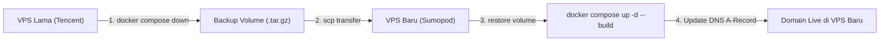

# 📋 Panduan Lengkap Migrasi Manual VPS — CycloPon Live Tracker

Dokumen ini adalah acuan resmi langkah demi langkah (*runbook*) untuk memindahkan sistem **CycloPon Live Tracker** dari VPS lama (Tencent Cloud: `43.173.51.161`) ke VPS baru (Sumopod / Ubuntu Server 24.04 LTS).

---

## 🏗️ 1. Ikhtisar Arsitektur yang Dipindahkan

Sistem CycloPon berjalan di atas Docker Compose (`docker-compose.prod.yml`) yang terdiri dari 3 kontainer dan persistent data:
1. **Caddy Proxy (`cyclopon-proxy`)**: Reverse proxy otomatis SSL/HTTPS (Port 80, 443).
2. **CycloPon Node.js App (`cyclopon-app`)**: Backend Express, WebSocket Live Map, API Telemetri (Port internal 3000).
3. **Traccar GPS Engine (`cyclopon-traccar`)**: OsmAnd GPS protocol server (Port 5055, internal 8082).
4. **Persistent Docker Volumes**:
   * `cyclopon_data`: Database SQLite (`cyclopon.db`, WAL, and SHM).
   * `cyclopon_gpx`: Berkas rute event balap (`*.gpx`).
   * (Opsional) `traccar_data` & `traccar_logs`.



---

## ⚙️ 2. Persiapan Port Firewall di VPS Baru (Sumopod)
Sebelum memulai, pastikan Firewall / Security Group di panel Sumopod mengizinkan port berikut:
* **Port 22 (TCP):** SSH Remote Management.
* **Port 80 (TCP):** HTTP (Redirect Caddy & sertifikasi Let's Encrypt).
* **Port 443 (TCP & UDP):** HTTPS & HTTP/3 QUIC (Web Live Map aman).
* **Port 5055 (TCP):** Protokol GPS OsmAnd / Traccar Client (titik koordinat dari HP rider).

---

## 🚀 3. Prosedur Eksekusi Langkah demi Langkah

### Langkah 1: Persiapan VPS Baru (Sumopod)
Setelah VPS baru selesai dibuat di Sumopod:

1. **Masuk ke VPS Baru via SSH:**
   ```bash
   ssh root@<IP_VPS_SUMOPOD_BARU>
   ```

2. **Perbarui sistem dan instal Docker, Docker Compose, & Git:**
   ```bash
   apt update && apt upgrade -y
   apt install -y docker.io docker-compose-plugin git curl
   systemctl enable --now docker
   ```

3. **Buat direktori kerja dan clone repositori CycloPon:**
   ```bash
   mkdir -p /home/ubuntu/cyclopon
   cd /home/ubuntu
   git clone https://github.com/USERNAME/cyclopon.git cyclopon
   cd /home/ubuntu/cyclopon
   ```

---

### Langkah 2: Backup Data di VPS Lama (Tencent Cloud)
Buka terminal dan login ke VPS lama (`43.173.51.161`):

1. **Masuk ke folder proyek dan hentikan container sementara:**
   ```bash
   cd ~/cyclopon
   docker compose -f docker-compose.prod.yml down
   ```
   *(Tindakan ini memastikan seluruh transaksi database SQLite tersimpan sempurna dan tidak ada penulisan data yang tertahan di memory/WAL).*

2. **Ekspor isi Docker volume ke berkas arsip `.tar.gz`:**
   ```bash
   # 1. Ekspor database SQLite (cyclopon_data)
   docker run --rm -v cyclopon_data:/data -v $(pwd):/backup alpine tar czf /backup/cyclopon_data.tar.gz -C /data .

   # 2. Ekspor berkas rute GPX (cyclopon_gpx)
   docker run --rm -v cyclopon_gpx:/gpx -v $(pwd):/backup alpine tar czf /backup/cyclopon_gpx.tar.gz -C /gpx .
   ```

---

### Langkah 3: Transfer Data dari VPS Lama ke VPS Baru
Masih di terminal VPS lama, salin berkas `.env` dan kedua arsip data langsung ke VPS Sumopod:

```bash
scp .env cyclopon_data.tar.gz cyclopon_gpx.tar.gz root@<IP_VPS_SUMOPOD_BARU>:/home/ubuntu/cyclopon/
```
*(Masukkan kata sandi root VPS Sumopod saat diminta)*.

> **Tips Kesiapsiagaan:** Setelah file terkirim, jika VPS lama masih ingin dinyalakan kembali selama masa persiapan, cukup jalankan:
> ```bash
> docker compose -f docker-compose.prod.yml up -d
> ```

---

### Langkah 4: Restore Data & Nyalakan Sistem di VPS Baru (Sumopod)
Kembali ke terminal VPS baru (Sumopod):

1. **Masuk ke direktori proyek:**
   ```bash
   cd /home/ubuntu/cyclopon
   ```

2. **Buat Docker volume baru dan pulihkan (*restore*) datanya:**
   ```bash
   # Buat volume dan ekstrak database SQLite
   docker volume create cyclopon_data
   docker run --rm -v cyclopon_data:/data -v $(pwd):/backup alpine tar xzf /backup/cyclopon_data.tar.gz -C /data

   # Buat volume dan ekstrak berkas GPX
   docker volume create cyclopon_gpx
   docker run --rm -v cyclopon_gpx:/gpx -v $(pwd):/backup alpine tar xzf /backup/cyclopon_gpx.tar.gz -C /gpx
   ```

3. **Periksa kelengkapan file `.env` di VPS Baru:**
   ```bash
   ls -la .env
   cat .env
   ```
   *(Pastikan variabel seperti `DOMAIN`, `ADMIN_PASSWORD`, `TELEGRAM_BOT_TOKEN`, dan `SESSION_SECRET` sudah terisi persis seperti di server lama).*

4. **Nyalakan seluruh sistem CycloPon di VPS Baru:**
   ```bash
   docker compose -f docker-compose.prod.yml up -d --build
   ```

5. **Verifikasi status kontainer:**
   ```bash
   docker compose -f docker-compose.prod.yml ps
   ```
   Pastikan ketiga kontainer (`cyclopon-proxy`, `cyclopon-app`, dan `cyclopon-traccar`) berstatus `Up` / `running` / `healthy`.

---

### Langkah 5: Pengalihan Domain (DNS Switch)
1. Buka dashboard DNS registrar domain Anda (misal Cloudflare, Niagahoster, Rumahweb, dll).
2. Temukan baris **A Record** untuk domain CycloPon (misal: `cyclopon.yourdomain.com`).
3. Ganti IP lama `43.173.51.161` dengan **Alamat IP VPS Sumopod Baru**.
4. Simpan perubahan.
5. Caddy di VPS Sumopod akan mendeteksi domain dan otomatis meminta sertifikat SSL HTTPS baru ke Let's Encrypt dalam waktu 1–2 menit.

---

### Langkah 6: Pembaruan Runner Deployment Lokal
Setelah server baru aktif dan domain berpindah, perbarui konfigurasi deploy di laptop/komputer kerja Anda:

Buka berkas `scripts/deploy-runner.js` (atau `.env` lokal) dan ubah:
```javascript
const VPS_IP = process.env.VPS_IP || '<IP_VPS_SUMOPOD_BARU>';
```
Uji deploy otomatis dari lokal:
```bash
npm run deploy:vps
```

---

## 🔄 4. Rencana Pemulihan Darurat (*Rollback Plan*)
Jika terjadi kendala tak terduga pada server baru saat proses pengalihan:
1. Kembalikan **A Record** DNS di registrar domain ke IP lama: `43.173.51.161`.
2. Pastikan kontainer di VPS lama aktif:
   ```bash
   docker compose -f docker-compose.prod.yml up -d
   ```
3. Dalam hitungan menit, seluruh traffic akan kembali ke server lama tanpa kehilangan data.

---

## ✅ 5. Checklist Verifikasi Pasca-Migrasi
Setelah domain mengarah ke VPS baru, buka browser dan lakukan pengecekan:
- [ ] Buka `https://<domain>` -> halaman beranda terbuka dengan gembok SSL HTTPS valid.
- [ ] Login ke Dashboard Admin (`/admin/dashboard`).
- [ ] Buka salah satu rute event balap dan pastikan garis peta rute GPX muncul dengan sempurna.
- [ ] Buka Live Map (`/watch/<id>`) dan pastikan indikator status bertuliskan `● LIVE STREAM`.
- [ ] Kirimkan 1 uji coba sinyal GPS dummy via OsmAnd port 5055 atau browser cockpit untuk memastikan koordinat terupdate secara real-time.
- [ ] Biarkan VPS lama tetap menyala sebagai cadangan selama 2–3 hari sebelum dinonaktifkan permanen.
